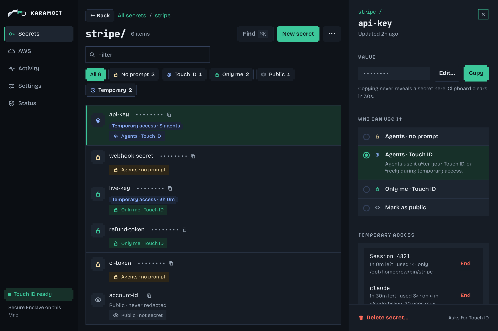

<p align="center">
  
</p>

<h1 align="center">Karambit</h1>

<p align="center"><strong>Hassle-free secret manager for you and your agents.</strong></p>

[](LICENSE)


Karambit is alpha software, not independently audited, and macOS only for now.

Karambit is a local-first secrets management layer for you and your AI coding agents. Keep your
secrets in one encrypted vault on your machine, rather than scattered across chat messages, notes
and project files. Manage who can use each secret, grant temporary access, and revoke access from
one place.

You get a CLI (`karambit`) and a desktop app. No cloud service, no account.

Agents can use secrets without you pasting the values into their prompts. Karambit passes a secret
to the program it starts and redacts supported matches from that program's stdout and stderr.
Any agent that can run shell commands can use the CLI. See [Security and limits](#security-and-limits)
for what this protects and what it does not.

<p align="center">
  
</p>

> **Read this first.** A program that `karambit run` starts gets the secret value in its environment.
> That program can read, copy or send the value. Redaction does not make the program safe.
> Blocking an agent stops new requests. It cannot take back a secret that a program already has.

## Install

You need git, Rust, the Xcode command line tools (Swift) and Node. `npm ci` needs network access.
Run `install.sh` from a plain terminal, not from an agent session.

```sh
git clone https://github.com/AmazingCarbon/karambit && cd karambit
./install.sh             # installs the CLI in ~/.local/bin and the app in ~/Applications
karambit init --paper    # makes a paper backup key
```

Write the backup key on paper and keep it somewhere safe. Karambit shows it once and asks you to
type it again to confirm. `karambit recover` uses this key if you lose access to your Touch ID keys.
Run `karambit backup verify` now and then to check it against your secrets.
See [backup and recovery limits](docs/reference.md#limits-full-list) before you need them.

To upgrade, pull and run `./install.sh` again. If the binaries change, the installed version asks
for Touch ID to trust the new ones before it replaces them. The upgrade stops the daemon, which
ends active temporary access, including YOLO.

Builds are ad-hoc signed on your computer. They are not notarized yet.

## Quick start

Store a secret, find it, and use it:

```sh
karambit add stripe/key --access agents-touch  # type the value at a hidden prompt
karambit ls                                   # names and access levels, no values
karambit run -e STRIPE_KEY=stripe/key -- ./deploy.sh
karambit get stripe/key                       # copies to your clipboard; not for agents
```

Replace `./deploy.sh` with the program you want to run. For supported matches in its output,
Karambit shows `[REDACTED:stripe/key]` instead of the value. See [redaction limits](#security-and-limits).

To set up your agent, copy the block in [docs/agents.md](docs/agents.md) into your `AGENTS.md` or
`CLAUDE.md`. The agent can read the command guide with `karambit help agent`.

## Access levels

Each secret has one access level. Set it with `--access` or in the app.

| Access level | `--access` | Agent can use it with `run` | Touch ID |
|---|---|---|---|
| Public (not secret) | `public` | yes, and it is not redacted | no |
| Agents | `agents` | yes | no |
| Agents + Touch ID | `agents-touch` | yes, after you approve | each use, or a lease |
| Only me + Touch ID | `me-touch` | no, except during approved folder YOLO | yes |

Public and Agents secrets have no Touch ID. Any program that runs as you can read them without
Karambit. Use a Touch ID access level for important secrets.

- **Temporary access (a lease).** Let an agent use a secret for a limited time. You can also limit
  the command and number of uses. A secret holds one lease per agent, up to 8. A new grant replaces
  only that agent's lease. See [lease commands and limits](docs/reference.md#leases-daemon).
- **YOLO for a folder.** One Touch ID gives the chosen agent temporary access to non-public keys
  below a folder, including Only me keys. It also covers keys added or moved there later through
  Karambit. Stored access levels and output redaction stay unchanged. YOLO ends on expiry, End,
  agent blocking or daemon restart—not on screen lock. The app defaults to 6 hours; the limit is
  7 days. See [coverage and limits](docs/reference.md#yolo-for-a-folder).
- **Block.** `karambit block --all` refuses new agent requests until you unblock. It does not stop
  running programs or take back secrets they already have.

These rules depend on agent detection, which is not a guarantee. See [Security and limits](#security-and-limits).

## The desktop app

The same vault as the CLI, with secrets masked. The screenshot above uses sample data.

- **Temporary access.** One row per agent, each with its own End button. Up to 8 agents per secret.
- **YOLO for a folder.** Approve temporary access with Touch ID. See when it is active and end it from the app.
- **Block all agents.** Refuse new agent requests until you unblock. This does not stop running programs
  or take back secrets they already have.

## Common tasks

**Keep secrets in order.**
Use names such as `stripe/key` or `deploy/token` to group secrets into folders. Rename a key or move
a folder without copying the values by hand:

```sh
karambit mv stripe/key payments/stripe
karambit mv deploy/ production/
```

A move keeps the value and access level, asks for Touch ID, and ends temporary access on the old
names. Update scripts that use those names. You can also edit names, values and access in the app.
Karambit does not find or remove old copies from chats, notes or other files.

**Choose who can use a secret.**
Change its access level, give an agent temporary access, or end that access:

```sh
karambit policy payments/stripe --access agents-touch
karambit lease grant payments/stripe --to pi --hours 1 --cmd curl
karambit lease revoke payments/stripe --to pi
```

A command limit is not a sandbox. For scripts, use a script pin rather than a bare interpreter.
See [lease commands and limits](docs/reference.md#leases-daemon).

**Use AWS without copying keys into your shell.**
Store access keys or sign in with IAM Identity Center (SSO), then run:

```sh
karambit aws PROFILE -- aws s3 ls
```

The AWS CLI and SDKs get credentials through a local endpoint, not as AWS keys in the environment.
The program still receives the credentials. This applies to `karambit aws` and `karambit run --aws`,
not plain `run -e`. See [AWS setup, SSO and role import](docs/aws.md).

**Move a project's `.env` files into the vault.**
`karambit secure` (alias: `karambit eat`) stores each secret and writes a `.env.schema` with no values.
It also adds `karambit run --` to supported npm scripts, so you can keep using commands such as
`npm run dev`.

```sh
karambit secure --dry-run    # shows names only; agents can run this
karambit eat                 # same as karambit secure
```

`karambit secure rebuild` puts the original files back. See [supported files, scripts and limits](docs/secure.md).

For the fixed CI build-status request, see [fixed tool calls](docs/reference.md#fixed-tool-calls-mode-c).
This is not a general API broker.

## Security and limits

Karambit encrypts each secret with its own key (ChaCha20-Poly1305). Secure Enclave keys that cannot
be exported wrap those keys. Touch ID protects unwraps where required; approved temporary access
can allow use without another prompt. A paper backup key provides a separate recovery path.

The installer uses the macOS hardened runtime to block debugger attachment and `DYLD_*` injection
into the signed binaries. This does not protect every file or process that runs as you.

Keep these limits in mind:

- **The program gets the secret.** It can copy or send it. Other processes that run as you can read
  its environment. End access or block an agent to stop future requests, not to recall released values.
- **Redaction is not a sandbox.** It removes exact copies of non-public values of at least 4 bytes,
  and 16-byte fragments of values of 32 bytes or more, from stdout and stderr. It does not cover
  encoded values, files or network traffic. Public values are not redacted. `run --jail` is experimental;
  do not treat it as a security boundary.
- **Agent detection can be bypassed.** Karambit uses process ancestry, names and environment markers.
  A caller it detects as an agent cannot get a non-public secret, add or remove secrets, relax a policy
  or grant access. A caller that evades detection can look like a human. Use Touch ID for important secrets.
- **No-prompt secrets are readable by programs that run as you.** Encryption at rest does not make
  the Public and Agents levels a barrier against those programs.
- **Your account can change Karambit's files.** Config, trust pins and installed binaries are writable
  by your user. If your agent has a filesystem sandbox, [deny writes to these files](docs/agents.md#run-the-agent-in-a-sandbox).
  Keep macOS Remote Login off unless you need it; see the [same-user and SSH limits](docs/threat-model.md#4-same-user-limits).
- **Trust the code you run.** A script pin does not cover its imports or config. Karambit drops
  code-loading environment variables for detected agents, but human runs keep them. See the
  [full limits](docs/reference.md#limits-full-list) before you allow exceptions.
- **Audit is best effort, not tamper-proof.** A process that runs as you can rewrite the log.
  Pass secrets through `-e`, not as command-line values; audit masking cannot catch every form.

Run `karambit doctor --agent-env` from a plain shell and from inside your agent, then compare.
It checks that environment for that run only. A pass is not a safety guarantee.

For details, read the [threat model](docs/threat-model.md) and [full limits](docs/reference.md#limits-full-list).
These cover trust pins, SSH, environment handling, recovery and more.
See [how it works](docs/how-it-works.html) for diagrams, and [AWS session limits](docs/aws.md)
for credentials that can outlive a Karambit grant.

## Roadmap

Our goal is one place to manage secrets and control how your tools use them. Keep them in the local
vault or connect your own secret engine. Both belong in OSS, along with security fixes and hardening.

For local storage, we aim to use the strongest platform protection we can properly support, including
hardware-backed security where available. No silent fallback to weaker protection. For linked secrets,
the external engine stays in control of permissions and lifetime; persistent local copies are not the default.

This is our planned order, not a release schedule. Security work continues through every stage.

1. **Make the foundation dependable.** Signed and notarized macOS releases, Homebrew installation,
   clearer upgrades, and backup and recovery tested on a clean machine. Add memory locking and
   core-dump protection where supported, and seek an independent security review.
   Hardened-runtime signing is already in the installer.
2. **Make everyday secret management easier.** Better search, descriptions, service links and review
   dates. Add bulk organisation and desktop import, starting with `.env` files, with previews and
   duplicate handling. Import will not remove old copies from chats or files.
3. **Make access clear.** Show stored access, temporary grants and YOLO together without mixing them up.
   Explain why a request was allowed or refused. Make scope, expiry and activity easier to inspect.
   Extend existing controls before adding separate access modes.
4. **Connect external secret engines.** Stabilise the backend interface and ship one tested connector
   before adding more. Define authentication, caching, expiry, rotation and offline behavior for each.
   AWS Secrets Manager is the first candidate, not yet a committed integration. Connecting your own
   supported engine will not require a paid edition.
5. **Keep credentials out of more programs.** Start with one narrow API proxy or broker workflow.
   Keep the real credential in Karambit and restrict where it can be used. Clearly distinguish this
   from direct access, where the program receives the value.
6. **Support unattended tools.** Define a non-interactive flow for CI jobs and services, with workload
   identity and short-lived credentials where the source supports them. Do not depend on a person's
   Touch ID session for unattended work.
7. **Add interfaces and platforms.** An MCP server that uses the same access rules, then secure Linux
   and Windows implementations. Each platform must pass its own security and recovery checks, not
   just compile. These efforts can proceed separately when their foundations are ready.

Linked sources currently have a [backend interface](docs/backend-contract.md), but this build has no
built-in backends. The core and CLI compile for Linux; the Linux security features are not implemented yet.

## Documentation

| Document | Contents |
|---|---|
| [docs/agents.md](docs/agents.md) | Instructions to copy into your agent's `AGENTS.md` |
| [docs/secure.md](docs/secure.md) | `karambit secure` and the `.env.schema` format |
| [docs/aws.md](docs/aws.md) | AWS profiles, SSO portals, role import |
| [docs/reference.md](docs/reference.md) | All commands, the key model, leases, policy, full limits |
| [docs/threat-model.md](docs/threat-model.md) | What is protected, and what is not |

## Contributing

The code has four parts:

```text
crates/core   Rust: encryption, store, policy, agent detection, redaction, audit
crates/cli    Rust: the karambit command
se-helper/    Swift: Secure Enclave keys and Touch ID (macOS)
app/          Tauri desktop app (plain HTML/JS)
```

Test the code you change with a test-name filter. For example:

```sh
RUST_TEST_THREADS=4 cargo test -p karambit-core --lib lease
```

These tests use software keys; no Secure Enclave or Touch ID is needed.
Open an issue before a large change, and read [CONTRIBUTING.md](CONTRIBUTING.md) first. Report security
problems privately, as described in [SECURITY.md](SECURITY.md), not in a public issue.

## Project files

- [SECURITY.md](SECURITY.md): how to report a vulnerability privately
- [CONTRIBUTING.md](CONTRIBUTING.md): build, test and pull request rules
- [CHANGELOG.md](CHANGELOG.md): what changed in each version

## License

Apache License 2.0. See [LICENSE](LICENSE) and [NOTICE](NOTICE).
Third-party components, including varlock's @env-spec parser (MIT): [THIRD_PARTY_NOTICES.md](THIRD_PARTY_NOTICES.md).
